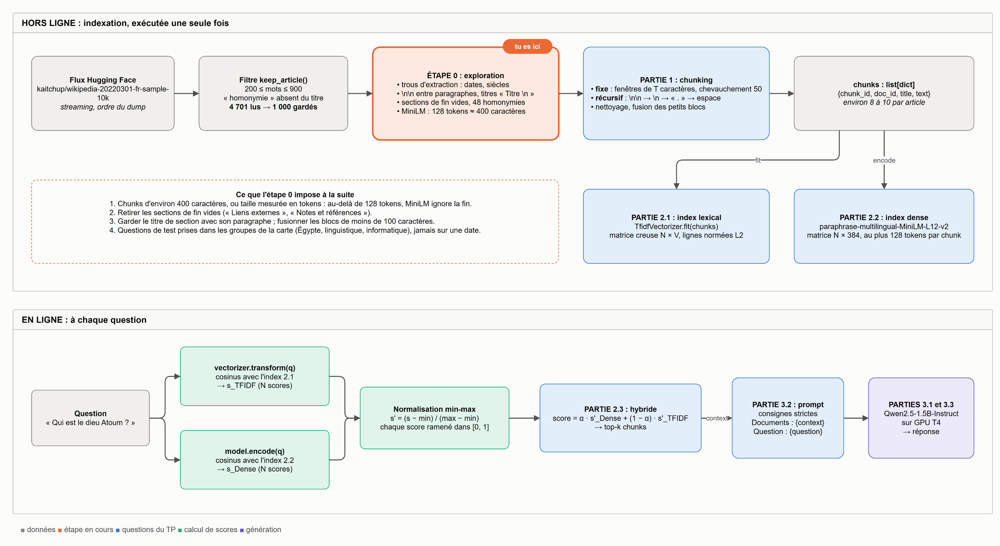
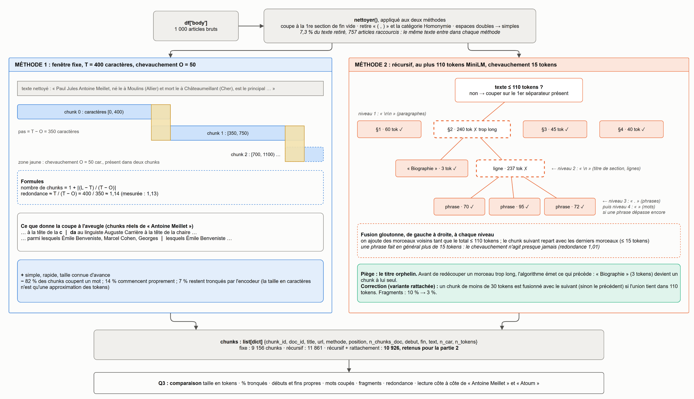
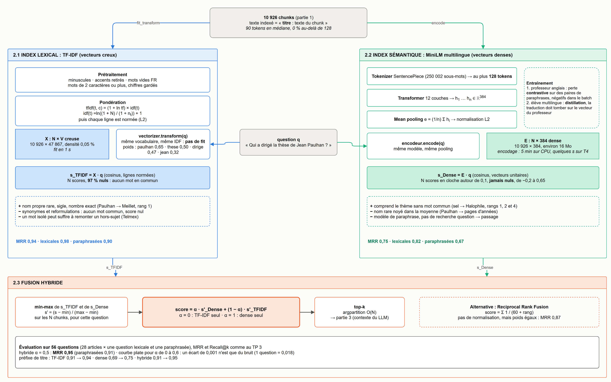
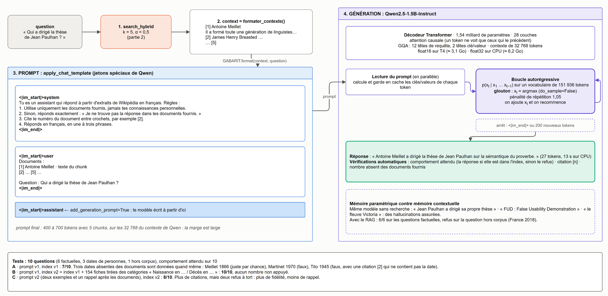

# RAG sur Wikipédia en français

TP du module *Data Embedding and Learning* (M2 MLSD, Université Paris Cité).

Ce système répond à des questions sur 1 000 articles de Wikipédia en français. Il découpe les articles en passages (*chunks*), retrouve les plus pertinents par une recherche lexicale, sémantique puis hybride, et fait rédiger la réponse par un petit modèle de langage, à partir de ces passages seulement.

| | |
|---|---|
| Corpus | 1 000 articles de 200 à 900 mots, découpés en 10 926 chunks |
| Recherche | TF-IDF + `paraphrase-multilingual-MiniLM-L12-v2`, fusion hybride : **MRR 0,95** sur 56 questions de test |
| Génération | `Qwen2.5-1.5B-Instruct` : **10 réponses attendues sur 10** après correction des données |

Rendu final : [présentation en 6 diapositives](rendu/Sylla_Nfaly_RAG_presentation.pdf) et [rapport d'une page](rendu/Sylla_Nfaly_RAG_rapport.pdf).



## Contenu du dépôt

| Chemin | Contenu |
|---|---|
| `SYLLA_NFALY_RAG_indexation.ipynb` | Le notebook complet, exécuté, avec ses sorties : énoncé, étape 0 d'exploration, parties 1 à 3 |
| `figures/` | Les graphiques produits par le notebook (exploration, comparaison des découpages, choix de α) |
| `figures/08_chunks_cote_a_cote.html` | Lecture côte à côte des chunks de deux articles, à ouvrir dans un navigateur après avoir cloné le dépôt |
| `diagrams/` | Un schéma par partie, au format draw.io (modifiable) et PNG |
| `rendu/` | La présentation et le rapport d'une page du rendu final (PDF) |
| `requirements.txt` | Les bibliothèques nécessaires |

Le dossier `data/` n'est pas versionné. Le notebook le recrée : il y enregistre le corpus téléchargé et le cache des embeddings.

## Lancer le notebook

J'ai exécuté le notebook en local, dans un environnement Python installé à partir de `requirements.txt` : les sorties enregistrées viennent de cette exécution. Le notebook fonctionne aussi tel quel sur Google Colab. Je suis passé en local parce que Colab devenait instable sur les étapes les plus lourdes, l'encodage complet du corpus et le chargement de Qwen.

### En local (l'environnement des sorties enregistrées)

```bash
python -m venv .venv
.venv/bin/pip install -r requirements.txt   # sous Windows : .venv\Scripts\pip
```

Ouvrez ensuite le notebook avec Jupyter ou VS Code. Sans GPU, tout fonctionne mais lentement : Qwen tourne en float32 (6,2 Go de RAM), chaque encodage complet du corpus prend environ 5 minutes et chaque réponse de 10 à 40 secondes.

### Sur Google Colab

1. Menu *Fichier*, *Importer le notebook*, puis choisir `SYLLA_NFALY_RAG_indexation.ipynb`.
2. Menu *Exécution*, *Modifier le type d'exécution*, puis **GPU T4**.
3. Menu *Exécution*, *Tout exécuter*. La première cellule de code installe les trois bibliothèques que Colab n'a pas toujours.

Le notebook détecte le GPU tout seul. L'encodeur et Qwen tournent alors sur la T4, et Qwen y est chargé en float16 (environ 3,1 Go).

## Schémas et figures d'analyse

Les schémas résument chaque partie. Les fichiers `.drawio` s'ouvrent et se modifient dans [diagrams.net](https://app.diagrams.net).

| Schéma | Image | Source modifiable |
|---|---|---|
| Pipeline complet, de l'exploration à la réponse | [00_pipeline_rag.png](diagrams/00_pipeline_rag.png) | [00_pipeline_rag.drawio](diagrams/00_pipeline_rag.drawio) ([ouvrir dans diagrams.net](https://app.diagrams.net/#Uhttps%3A%2F%2Fraw.githubusercontent.com%2F8sylla%2Frag-wikipedia-fr%2Fmain%2Fdiagrams%2F00_pipeline_rag.drawio)) |
| Partie 1 : découpage fixe et récursif | [01_chunking.png](diagrams/01_chunking.png) | [01_chunking.drawio](diagrams/01_chunking.drawio) ([ouvrir dans diagrams.net](https://app.diagrams.net/#Uhttps%3A%2F%2Fraw.githubusercontent.com%2F8sylla%2Frag-wikipedia-fr%2Fmain%2Fdiagrams%2F01_chunking.drawio)) |
| Partie 2 : TF-IDF, dense et hybride | [02_retrieval.png](diagrams/02_retrieval.png) | [02_retrieval.drawio](diagrams/02_retrieval.drawio) ([ouvrir dans diagrams.net](https://app.diagrams.net/#Uhttps%3A%2F%2Fraw.githubusercontent.com%2F8sylla%2Frag-wikipedia-fr%2Fmain%2Fdiagrams%2F02_retrieval.drawio)) |
| Partie 3 : prompt, génération et vérifications | [03_generation.png](diagrams/03_generation.png) | [03_generation.drawio](diagrams/03_generation.drawio) ([ouvrir dans diagrams.net](https://app.diagrams.net/#Uhttps%3A%2F%2Fraw.githubusercontent.com%2F8sylla%2Frag-wikipedia-fr%2Fmain%2Fdiagrams%2F03_generation.drawio)) |

Les figures d'analyse sont produites par le notebook :

| Figure | Ce qu'elle montre |
|---|---|
| [01_filtre_longueur.png](figures/01_filtre_longueur.png) | L'effet du filtre de 200 à 900 mots sur les articles lus |
| [02_trous_extraction.png](figures/02_trous_extraction.png) | Les dates et les siècles effacés par l'extraction du dump |
| [03_structure_paragraphes.png](figures/03_structure_paragraphes.png) | La longueur des paragraphes et les titres de section les plus fréquents |
| [04_types_de_pages.png](figures/04_types_de_pages.png) | Les types de pages du corpus : personnes, listes, années, divinités, lieux |
| [05_tokens_encodeur.png](figures/05_tokens_encodeur.png) | La taille des fenêtres en tokens face à la limite de 128 tokens de l'encodeur |
| [06_carte_sujets.png](figures/06_carte_sujets.png) | La carte des sujets du corpus (TF-IDF, SVD, k-means et t-SNE) |
| [07_comparaison_chunking.png](figures/07_comparaison_chunking.png) | La comparaison des trois découpages |
| [08_chunks_cote_a_cote.html](figures/08_chunks_cote_a_cote.html) | La lecture côte à côte des chunks de deux articles (à ouvrir dans un navigateur après avoir cloné le dépôt) |
| [09_echelles_scores.png](figures/09_echelles_scores.png) | Les échelles des scores TF-IDF et denses, avant et après la normalisation min-max |
| [10_choix_alpha.png](figures/10_choix_alpha.png) | Le MRR selon la valeur de α dans la recherche hybride |

## Démarche et résultats

### Étape 0 : explorer le corpus avant de le découper

Cette étape n'est pas demandée par l'énoncé, mais elle a fixé presque tous les réglages de la suite.

- **Le filtre de longueur est sélectif** : il faut lire 4 701 articles pour en garder 1 000, et 67 % des articles lus dépassent 900 mots. Les grands sujets (pays, personnalités majeures) sont donc absents.
- **L'extraction du dump a effacé des informations** : dans 11 % des articles, la date de naissance ou de mort a disparu du texte (« né le  à Moulins ») ; dans 35 %, un siècle a disparu (« du . »).
- **48 pages d'homonymie** passent le filtre, qui ne regarde que le titre.
- **L'encodeur tronque au-delà de 128 tokens.** 74 % des fenêtres de 500 caractères, la taille proposée par l'énoncé, dépassent cette limite ; à 400 caractères, seulement 7 %.

### Partie 1 : découpage des documents

Trois variantes ont été comparées. Les deux méthodes reçoivent le même texte nettoyé, sans les sections de fin vides.

| | Fenêtre fixe (400 car.) | Récursif (110 tokens au plus) | Récursif + rattachement |
|---|---|---|---|
| Chunks | 9 156 | 11 861 | **10 926** |
| Tokens (médiane) | 109 | 80 | 85 |
| Tronqués par l'encodeur | 7 % | 0 % | 0 % |
| Mot coupé au début ou à la fin | 82 % | 0 % | 0 % |
| Début et fin propres | 14 % / 12 % | 99 % / 99 % | 99 % / 99 % |
| Fragments de moins de 100 caractères | 2 % | 10 % | 3 % |

Le découpage récursif suit la structure de l'article : paragraphes, puis lignes, phrases et mots. Il mesure la taille en tokens de l'encodeur. Il est écrit à la main, et ses chunks sont identiques à 100 % à ceux de `RecursiveCharacterTextSplitter` de `langchain-text-splitters` avec les mêmes réglages.

Le *rattachement* fusionne les chunks de moins de 30 tokens avec leur voisin. Il corrige les titres de section orphelins (« Histoire », « Biographie ») que l'algorithme récursif produit.



### Partie 2 : indexation et recherche

- **TF-IDF** : matrice creuse de 10 926 chunks sur 47 867 mots, accents retirés, mots vides français, `sublinear_tf`.
- **Dense** : vecteurs normalisés de 384 dimensions.
- **Hybride** : scores ramenés dans [0, 1] par min-max, puis `α * dense + (1 - α) * TF-IDF`.

Chaque chunk est indexé avec le titre de son article en préfixe. Un chunk comme « Il succéda au linguiste Auguste Carrière » ne nomme pas son sujet : le préfixe le lui rend.

Évaluation sur 56 questions, deux par article sur 28 articles : une question **lexicale** et une **paraphrasée**. Résultats en MRR :

| | Lexicales | Paraphrasées | Toutes |
|---|---|---|---|
| TF-IDF | 0,98 | 0,90 | 0,94 |
| Dense | 0,82 | 0,67 | 0,75 |
| **Hybride, α = 0,5** | 0,98 | **0,91** | **0,95** |
| Reciprocal Rank Fusion | 0,96 | 0,77 | 0,87 |

Le préfixe de titre améliore toutes les méthodes fondées sur les scores, par exemple de 0,91 à 0,95 pour l'hybride. Entre α = 0 et α = 0,6, les écarts sont inférieurs au poids d'une seule question.



### Partie 3 : génération de la réponse

`ask_wikipedia(query)` récupère les 5 meilleurs chunks par recherche hybride, les numérote et les titre dans le prompt, puis génère la réponse. Le prompt impose quatre règles : documents seulement, phrase de refus exacte, citation `[n]`, une à trois phrases. Le décodage est glouton, pour des réponses reproductibles.

Dix questions de test : six factuelles, trois dates de personnes et une hors corpus. Chaque réponse est vérifiée automatiquement : réponse juste (ou refus si les documents ne la contiennent pas), présence d'une citation, nombres absents des documents fournis.

| Configuration | Réponses attendues | Avec citation | Avec un nombre inventé |
|---|---|---|---|
| A : prompt de base, index de la partie 2 | 7/10 | 2 | 3 |
| B : + une fiche par article tirée de ses catégories | **10/10** | 2 | **0** |
| C : B + un prompt avec deux exemples | 8/10 | 6 | 0 |

- **Sans recherche**, le même modèle invente avec assurance : « FUD : *False Usability Demonstration* », « le fleuve Victoria ».
- **Configuration A.** Le RAG donne trois dates qui ne figurent dans aucun document, dont une avec une citation `[2]` qui ne la contient pas. En remontant aux données, les dates étaient rangées dans les **catégories** de fin d'article (« Naissance en novembre 1866 »), et le nettoyage de la partie 1 les supprimait. Les ajouter sous forme de fiches (configuration B) règle le problème.
- **Configuration C.** Montrer des exemples au modèle le fait citer plus souvent, mais le rend aussi trop prudent : il refuse deux réponses pourtant présentes.



## Limites

- Les questions de test ont été écrites en lisant les articles. Même « paraphrasées », elles reprennent des mots du texte, ce qui avantage le TF-IDF. Avec 56 et 10 questions, les petits écarts ne sont pas significatifs.
- `paraphrase-multilingual-MiniLM-L12-v2` est un modèle de paraphrase, pas un modèle de recherche question-passage. Un modèle comme `multilingual-e5` ou BGE-M3 serait plus adapté.
- La normalisation min-max donne toujours 1 au meilleur chunk : elle ne permet pas de détecter qu'aucun document ne répond.
- Les sorties du notebook ont été obtenues sur CPU en float32. En float16 sur GPU, quelques réponses peuvent différer légèrement.

## Données et modèles

- Corpus : [`kaitchup/wikipedia-20220301-fr-sample-10k`](https://huggingface.co/datasets/kaitchup/wikipedia-20220301-fr-sample-10k), extrait du dump de Wikipédia en français du 1er mars 2022 (textes sous licence CC BY-SA).
- Encodeur : [`sentence-transformers/paraphrase-multilingual-MiniLM-L12-v2`](https://huggingface.co/sentence-transformers/paraphrase-multilingual-MiniLM-L12-v2).
- LLM : [`Qwen/Qwen2.5-1.5B-Instruct`](https://huggingface.co/Qwen/Qwen2.5-1.5B-Instruct).

## Environnement testé

Python 3.11, torch 2.15 (CPU), transformers 5.22, sentence-transformers 6.3, scikit-learn 1.9, datasets 5.2, pandas 3.1, langchain-text-splitters 1.1.

Avec une version de transformers antérieure à 4.56, remplacer `dtype=` par `torch_dtype=` au chargement de Qwen (cellule 3.1).

## Auteur

Nfaly Sylla, M2 MLSD, Université Paris Cité.
